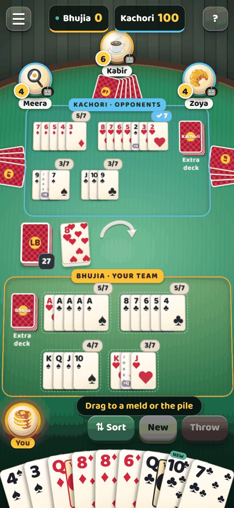
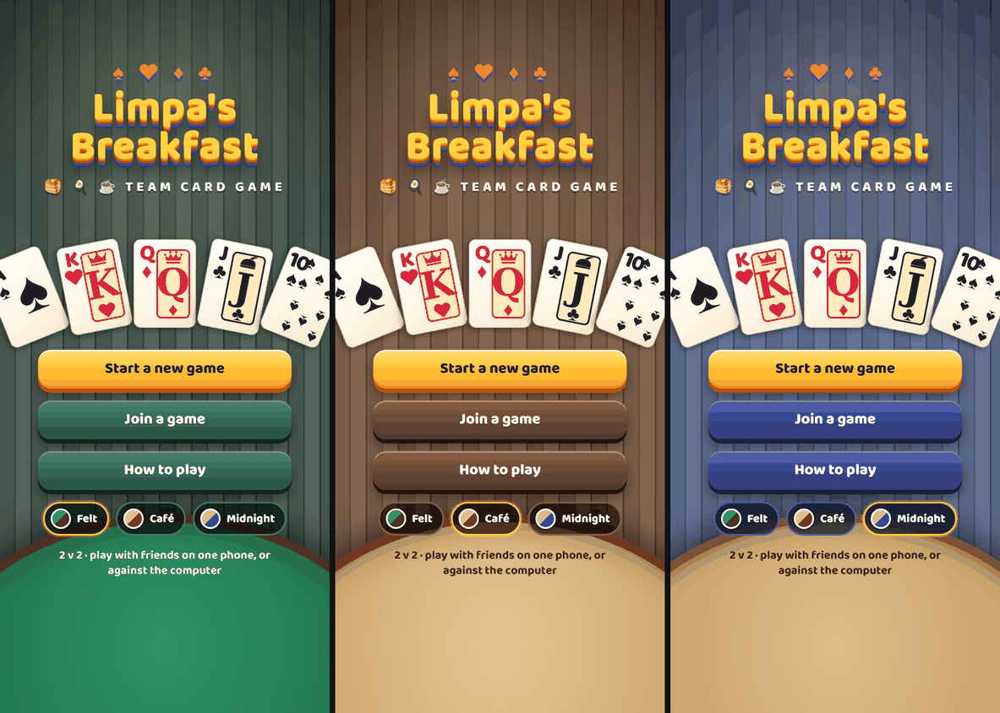

# Limpa's Breakfast

A team card game for four players (2v2): Bhujia vs Kachori. Play with friends passing one phone round, or against the computer.
It runs in the browser, installs to a phone's home screen, and works offline.

## Play it

Open `index.html` in a browser (it is built for a portrait phone; on a desktop it shows as a phone-width column), or serve the folder:
`python3 -m http.server 8000` and open `http://<your-computer>:8000` on a phone on the same network.

Pushing to `main` publishes the site with GitHub Pages (`.github/workflows/pages.yml`). In the repo's Settings > Pages, set the source to *GitHub Actions* once.
On a phone, "Add to Home Screen" installs it full-screen with its own icon.

## What is in the game

- **3D table.** A tilted table in real perspective, the other players' hands fanned face-down on it (with their real card counts),
  team mats for melds, the piles and the extra decks on the table, and your own hand fanned at the bottom. Cards fly between piles, hands and melds.
- **Colour themes.** *Felt* (green card table, default), *Café* (warm walnut) and *Midnight*. Pick one from the main menu or the in-game menu.
- **Computer players.** *Smart* (default) or *Easy* (the original prototype player), chosen in the lobby. See below.
- **Easy to read.** Large type, large buttons, high-contrast table labels, and all melds shown at once: the table tips flatter as it fills up before any card shrinks.
- **Sound.** Small synthesised effects with a mute toggle. No audio files.
- **Online rooms.** *Play online with friends* makes a room code like `LB-7KQ2M` plus a share link (system share sheet, WhatsApp, or copy).
  Friends open the link, type their name and join; the host picks which seats are friends and which are computers, then starts. See below.
- **Pass and play.** Make more than one seat Human and the phone shows a "pass the phone" screen between turns.

## Online rooms

Rooms are peer to peer (WebRTC through [PeerJS](https://peerjs.com), vendored in `js/vendor/`). There is no game server: the **host's phone runs the game**,
checks every move with the rules engine, and sends each guest a copy that contains only that guest's own hand (everyone else's hands, the stack and the extra
decks are blank on a guest's phone). The free public PeerJS broker only introduces the phones to each other.

- **Share:** the host shares the code or link; opening `...#room=LB-7KQ2M` goes straight to the Join screen with the code filled in.
- **Reconnecting:** phones in the background lose their connection (for example while sharing the link). Guests reconnect on their own and keep their seat.
  The host's game is saved on the host's phone, so after a reload the menu offers *Resume your room*.
- **Away players:** if a player is gone for 3 minutes the computer plays their seat until they return (rules section 11).
- **Limits:** the host's phone must stay open; if the host leaves, the room closes. Two phones behind strict networks may fail to connect directly; `js/net.js` lists the STUN/TURN
  servers used (a free community TURN relay is included as a fallback, and you can put your own there). Online rooms need a normal web page, so they do not work inside the claude.ai artifact preview.
- `node test/online-rooms.js` runs a two-phone test against the real broker.

## The computer players

`js/engine.js` holds the rules and both computer players. The **rules are unchanged** from the 2D prototype (`legacy/limpa-2d-prototype.html`); only the computer-player
section differs, and the original player is kept as the *Easy* level.

The *Smart* player uses wildcards instead of hoarding them, starts melds from any rank (and from two cards plus a wildcard), claims and uses its team's extra deck,
avoids throwing cards the other team can build on, throws what it can no longer use, and will not go out if that would lose the game.
Its weights are plain numbers in `CFG.smart` and can be overridden per seat.

Measured in `test/bot-arena.js` (1,000 games, sides swapped every game): **Smart beats Easy 63% to 29%** (8% draws), goes out three times as often,
and takes an extra-deck penalty in 0.12 games out of 1 (Easy: 0.65). Smart is also the stronger of the two in self-play tuning, where single-weight changes did not beat it.

## Repo layout

| Path | What it is |
|---|---|
| `index.html`, `manifest.webmanifest`, `sw.js`, `icons/` | Page shell, installable-app files and offline cache |
| `css/style.css` | The 3D scene, card faces, hand fan, buttons, screens and the three colour themes (tokens at the top) |
| `js/app.js` | UI: rendering, layout maths, drag and drop, timers, computer-player turns, card-flight animations, sound, themes |
| `js/net.js`, `js/vendor/peerjs.min.js` | Online rooms: peer-to-peer transport and the PeerJS library |
| `js/engine.js` | Rules engine and computer players |
| `docs/RULES.md` | The rules the engine enforces (v2.0, 2v2) |
| `legacy/limpa-2d-prototype.html` | The original single-file 2D prototype, for reference |
| `test/engine-smoke.js` | Plays 200 computer-only games (both levels) and checks cards are conserved and every game ends |
| `test/online-rooms.js` | Two-phone online test against the real broker (needs Playwright and internet) |
| `test/bot-arena.js`, `test/bot-tune.js` | Head-to-head games between computer levels or weight sets; self-play tuning |

`npm test` runs the smoke test; `npm run arena` runs the arena.

## How the 3D works

CSS 3D, not WebGL, so it stays a small static page that runs on any phone and keeps drag and drop and accessibility.

- `.stage` sets the perspective. `.plane` is the table top, tipped back with `rotateX`. Everything lying on the table is a child of the plane, so it foreshortens with the table.
  Your hand, the avatars and the buttons are flat layers on top.
- `metrics()` in `js/app.js` works out the hand rows and how deep the plane must be so its far edge lands under the avatars after perspective.
  `TILT0`, `TILT_MIN` and `PERSP` at the top of that file control how dramatic the table looks. `fitMelds()` shrinks cards, or tips the table flatter, only when a team has more melds than its mat holds.
- The DOM is rebuilt on every render, so card moves are animated by diffing card positions (`playFlights()`).

## Open questions

- **Orientation.** `docs/RULES.md` says the game is played with the phone held sideways, but the prototype and the reference design are portrait, so this UI is portrait.
- **Counts.** To keep the table uncluttered there are no card counts and no meld-progress badges (such as 3/7). Your rules say the centre stack count is always shown; it is hidden too, per the request to remove numbers.
- Court cards use a crowned-letter face rather than illustrated figures.
- Rules section 13 ("Not yet decided") is untouched.
