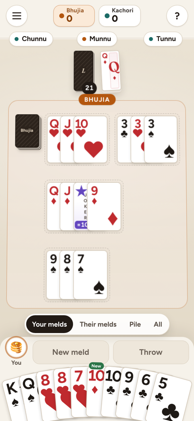
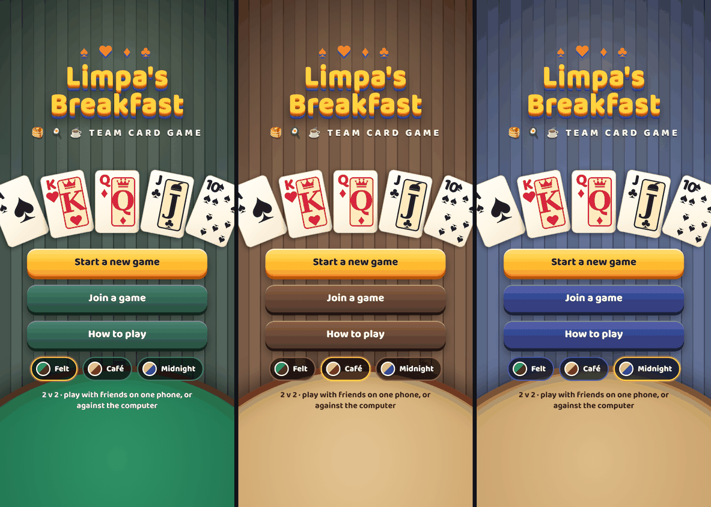

> Project memory lives in `vault/` (open it in Obsidian). See `CLAUDE.md`.

# Limpa's Breakfast

A team card game for four players (2v2): Bhujia vs Kachori. Play with friends passing one phone round, or against the computer.
It runs in the browser, installs to a phone's home screen, and works offline.

## Play it

Open `index.html` in a browser (it is built for a portrait phone; on a desktop it shows as a phone-width column), or serve the folder:
`python3 -m http.server 8000` and open `http://<your-computer>:8000` on a phone on the same network.

Pushing to `main` publishes the site with GitHub Pages (`.github/workflows/pages.yml`). In the repo's Settings > Pages, set the source to *GitHub Actions* once.
On a phone, "Add to Home Screen" installs it full-screen with its own icon.

## What is in the game

- **3D table.** A tilted table in real perspective, the other players' hands fanned face-down on it (with their real card counts),
  team mats for melds, the piles and the extra decks on the table, and your own hand fanned at the bottom. Cards fly between piles, hands and melds.
- **Colour themes.** *Felt* (green card table, default), *Café* (warm walnut) and *Midnight*. Pick one from the main menu or the in-game menu.
- **Computer players.** *Expert* (default, with lookahead), *Smart* or *Easy* (the original prototype player), chosen in the lobby. See below.
- **Three steps, one thing at a time.** A turn is shown as Step 1 *Draw*, Step 2 *Make melds*, Step 3 *Throw*. Each step shows only what matters: the deck and the pile in step 1,
  your team's melds in step 2, the pile in step 3, and both teams' melds while the others play. Three buttons (*Your melds / Their melds / Piles*) look at anything else.
- **Help.** A 💡 suggestion at every step in plain words ("Add the 7♦ to the glowing run"), with the cards or meld highlighted and a *Do it* button that plays it for you.
  It is the Smart computer player's choice, asked on your behalf. Suggestions can be switched off.
- **No questions about wildcards.** A Joker or 2 is placed automatically. Drag it to an exact spot on a meld if you want to choose.
- **Less fiddly.** No dragging needed: tap cards, then *Place*, or select cards and tap a meld to add them; tap a card and *Throw*. The hand sorts itself. Optional no-timer mode (solo games) and slow computer players, in the menu under *Comfort*.
- **Easy to read.** Large type, large buttons, high-contrast table labels, and all melds shown at once: the table tips flatter as it fills up before any card shrinks.
- **Sound.** Small synthesised effects with a mute toggle. No audio files.
- **Online rooms.** *Play online with friends* makes a room code like `482913` (six numbers) plus a share link (system share sheet, WhatsApp, or copy).
  Friends open the link, type their name and join; the host picks which seats are friends and which are computers, then starts. See below.
- **Pass and play.** Make more than one seat Human and the phone shows a "pass the phone" screen between turns.

## Online rooms

Rooms are peer to peer (WebRTC through [PeerJS](https://peerjs.com), vendored in `js/vendor/`). There is no game server: the **host's phone runs the game**,
checks every move with the rules engine, and sends each guest a copy that contains only that guest's own hand (everyone else's hands, the stack and the extra
decks are blank on a guest's phone). The free public PeerJS broker only introduces the phones to each other.

- **Share:** the host shares the code or link; opening `...#room=482913` goes straight to the Join screen with the code filled in.
- **Reconnecting:** phones in the background lose their connection (for example while sharing the link). Guests reconnect on their own and keep their seat.
  The host's game is saved on the host's phone, so after a reload the menu offers *Resume your room*.
- **Away players:** if a player is gone for 3 minutes the computer plays their seat until they return (rules section 11).
- **Limits:** the host's phone must stay open; if the host leaves, the room closes. Two phones behind strict networks may fail to connect directly; `js/net.js` lists the STUN/TURN
  servers used (a free community TURN relay is included as a fallback, and you can put your own there). Online rooms need a normal web page, so they do not work inside the claude.ai artifact preview.
- `node test/online-rooms.js` runs a two-phone test against the real broker.

## The computer players

`js/engine.js` holds the rules and the computer players. The **rules are unchanged** from the 2D prototype (`legacy/limpa-2d-prototype.html`); only the computer-player
section differs. There are three levels, chosen in the lobby (Expert is the default):

- **Easy** is the original prototype player, unchanged.
- **Smart** plays the way strong players do. Sets only from edge ranks (A, K, Q, J, 3, 4), never 777 or 888 until the game is nearly over, because those cards are needed for sequences.
  It counts cards (there are two decks, so it knows which cards are still out there), keeps a wildcard back while the natural card that would finish a pure meld is still likely to arrive,
  avoids throwing cards the other team can build on (including one gap away from the end of their run), claims and uses its extra deck, and will not go out if that would lose the game.
- **Expert** is Smart plus table memory, team play and lookahead.
  - *Memory:* it remembers what everyone saw: which pile cards each player took, which top cards they passed on, what they threw, and which cards would extend their melds that they still haven't played. From that it estimates the chance that each other player (opponents and partner) holds each card. Only public information is used; a test checks it never peeks.
  - *Team play:* it avoids throwing a card the next player (always an opponent) is likely to use to take the whole pile, more so the bigger the pile, and won't hand the other team the card that finishes one of their 6-card melds. Cards its partner is known to hold count as help for the team's melds, cards an opponent probably holds don't. While its team's extra deck is unclaimed it looks for a way to empty the hand and claim it.
  - *Lookahead:* for each card it might throw, it deals out everything it cannot see in plausible ways (cards seen going into a hand stay there, the rest follow the estimates, and every hand and the centre stack keep their exact sizes), plays each game out to the end, and throws the card that wins most often. It thinks for about 1.5 seconds per throw in a background thread, so the screen never freezes; a faster phone simply imagines more games.
  - Every computer player keeps its own memory and reads only that.

Measured with `node test/bot-eval.js` (sides swapped every game; "decisive" ignores draws):

| Match | Result |
|---|---|
| Smart vs Easy (2,000 games) | 64.8% to 28.1%, 69.7% of decided games |
| Smart vs the previous Smart (2,400 games) | 60.5% of decided games |
| Expert vs Smart (400 games) | 60.7% of decided games, average margin +66 points |
| Expert with memory and team play vs the previous Expert (480 games) | 59.3% of decided games, average margin +79 points |
| Smart + team play vs Smart (2,400 games) | 55.1% of decided games, average margin +51 points |
| Expert thinking longer (20 imagined deals per throw) vs 6 deals (240 games) | 58.1% of decided games, average margin +53 points |

Switching features off one at a time showed that edge-only sets are worth about 5.5 points of win rate and keeping wildcards for pure melds about 4.
A learned value-function player (trained by self-play on 450,000 positions) was also tried and played worse than the hand-built rules, so it was dropped.
The weights are plain numbers in `CFG.smart`; a seat can override any of them with `seat.params`, and `node test/bot-tune.js` searches for better ones.

## Repo layout

| Path | What it is |
|---|---|
| `index.html`, `manifest.webmanifest`, `sw.js`, `icons/` | Page shell, installable-app files and offline cache |
| `css/style.css` | The 3D scene, card faces, hand fan, buttons, screens and the three colour themes (tokens at the top) |
| `js/app.js` | UI: rendering, layout maths, drag and drop, timers, computer-player turns, card-flight animations, sound, themes |
| `js/net.js`, `js/vendor/peerjs.min.js` | Online rooms: peer-to-peer transport and the PeerJS library |
| `js/engine.js` | Rules engine and computer players |
| `docs/RULES.md` | The rules the engine enforces (v2.0, 2v2) |
| `docs/UX-AUDIT.md` | Usability audit: findings and what was fixed |
| `legacy/limpa-2d-prototype.html` | The original single-file 2D prototype, for reference |
| `test/engine-smoke.js` | Plays 200 computer-only games (both levels) and checks cards are conserved and every game ends |
| `test/online-rooms.js` | Two-phone online test against the real broker (needs Playwright and internet) |
| `test/bot-eval.js`, `test/bot-tune.js` | Parallel head-to-head games between computer levels or weight sets; self-play tuning |

`npm test` runs the smoke test; `npm run arena` runs a Smart-vs-Easy comparison.

## How the 3D works

CSS 3D, not WebGL, so it stays a small static page that runs on any phone and keeps drag and drop and accessibility.

- `.stage` sets the perspective. `.plane` is the table top, tipped back with `rotateX`. Everything lying on the table is a child of the plane, so it foreshortens with the table.
  Your hand, the avatars and the buttons are flat layers on top.
- `metrics()` in `js/app.js` works out the hand rows and how deep the plane must be so its far edge lands under the avatars after perspective.
  `TILT0`, `TILT_MIN` and `PERSP` at the top of that file control how dramatic the table looks. `fitMelds()` shrinks cards, or tips the table flatter, only when a team has more melds than its mat holds.
- The DOM is rebuilt on every render, so card moves are animated by diffing card positions (`playFlights()`).

## Open questions

- **Orientation.** `docs/RULES.md` says the game is played with the phone held sideways, but the prototype and the reference design are portrait, so this UI is portrait.
- **Counts.** To keep the table uncluttered there are no card counts and no meld-progress badges (such as 3/7). Your rules say the centre stack count is always shown; it is hidden too, per the request to remove numbers.
- Court cards use a crowned-letter face rather than illustrated figures.
- Rules section 13 ("Not yet decided") is untouched.
